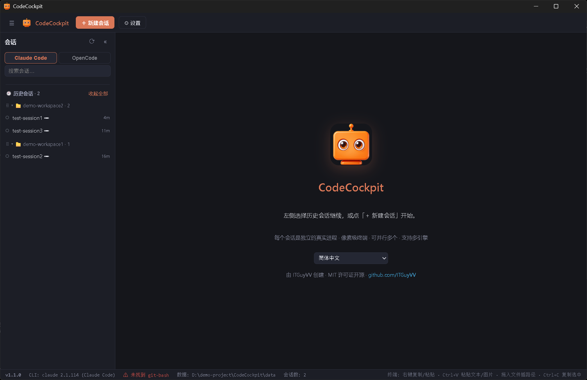
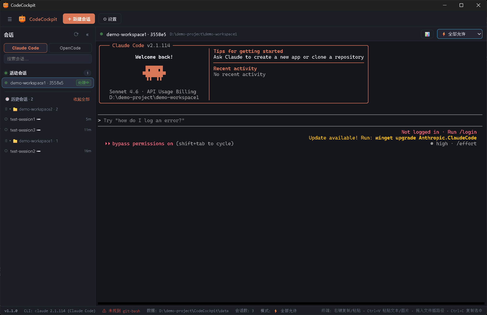
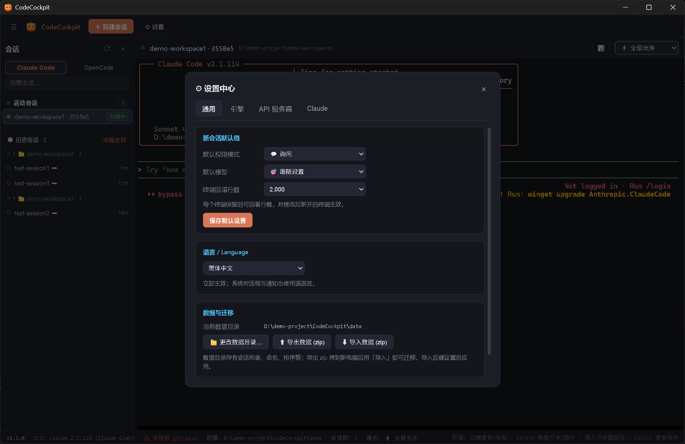
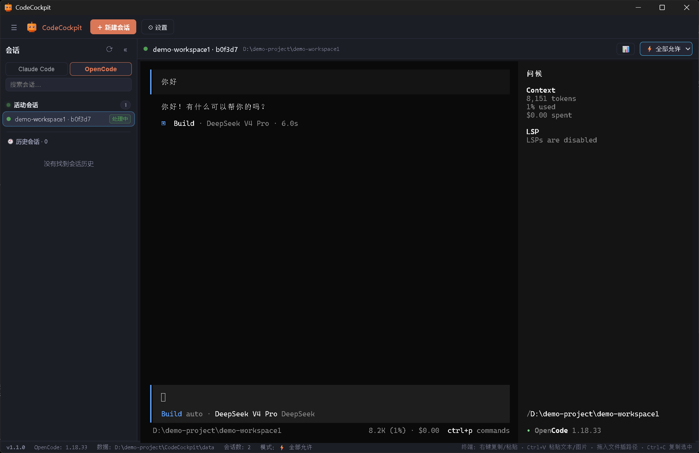

<div align="center">


# CodeCockpit

**你的 AI 编程智能体驾驶舱。**

在同一个原生窗口里运行、观测、管理多个 AI 编程 CLI 会话（当前支持 Claude Code 与 OpenCode，持续扩展中）——真实 PTY 终端、精确的 token/成本统计、完整的会话历史。

[](LICENSE)


[English](README.md) | 简体中文

</div>

---

## 为什么需要 CodeCockpit？

同时驾驭多个 AI 编程智能体意味着：在一堆原始终端窗口里来回切换、搞不清哪个会话烧了多少 token、手动翻历史记录文件。CodeCockpit 把这一切收进一个驾驶舱：

- 一个窗口，多个活跃智能体终端——每个都是真实 PTY，不是文本转储。
- 每个会话的遥测数据直接解析自各引擎自己的会话记录：模型、输入/输出 token、缓存读写、估算成本、工具调用分布、纯 AI 工作时长。
- 历史与工作区状态在重启后完整保留；任何历史会话一键续聊。
- 自带 API 中转——服务商配置可让任意会话走自定义端点（cc-switch 风格）。

## 界面预览



*欢迎页与会话启动*



*活跃会话与遥测仪表盘*



*页签式设置中心*



*历史中心（OpenCode 引擎）*

## 特性

- **双引擎驾驶舱** — Claude Code 与 OpenCode 并行使用，各自独立的历史中心；用不到的引擎可在设置中停用。
- **真实 PTY 终端** — 每个会话运行在独立的 ConPTY 进程中，由 xterm.js 完整渲染，支持选中、复制/粘贴、文件路径拖拽，可并行任意多个会话。
- **精确会话遥测** — 解析各引擎自己的会话记录（Claude jsonl / OpenCode 存储）：模型、输入/输出 token、缓存读/写、估算成本、轮次、工具调用排行、纯 AI 工作时长。
- **会话仪表盘** — 每个会话底部一条实时状态栏：上下文占用、输出速度、工具使用分布一目了然。
- **历史中心** — 汇集各引擎的全部本地会话，按项目分组，支持重命名、删除（带确认）、拖动排序、搜索、记录大小。分组默认折叠，一键全部展开。
- **工作区持久化** — 启动时完整恢复活跃会话列表；已退出的进程一键恢复。
- **API 服务商配置** — cc-switch 风格：每个引擎可配多个服务商（Base URL + API Key），一键连通性测试，模型映射（main/haiku/sonnet/opus 四档映射到任意模型），按会话环境变量注入或全局配置改写（改写前自动生成 `.bak` 备份）。
- **权限模式切换** — default / acceptEdits / plan / bypassPermissions 实时切换、上下文不丢；bypass 模式双重确认。
- **换目录续接上下文** — 项目搬家后切换 cwd 并续接同一会话，上下文原样保留。
- **完成通知** — 窗口在后台时智能体完成即弹系统通知，点击跳回。
- **退出确认** — 有会话在跑时关窗先询问（可选"不再提示"），误点不会误杀你的智能体。
- **设置中心** — 页签式：默认项（模式/模型、终端回滚行数）、引擎开关、服务商配置、Claude 配置快捷入口 + MCP 服务器概览；数据目录可迁移，支持 zip 导出/导入。
- **10 种语言** — English、简体中文、繁體中文、日本語、한국어、Deutsch、Français、Español、Português (Brasil)、Русский。设置里随时切换。

## 下载与安装

从 [Releases](../../releases) 获取最新构建：

| 平台 | 产物 | 安装方式 |
| --- | --- | --- |
| Windows 10/11（x64） | `CodeCockpit-<版本>-win-x64.zip` | 解压到任意目录运行 `CodeCockpit.exe`（便携式——升级直接覆盖目录） |
| Windows 11（arm64） | `CodeCockpit-<版本>-win-arm64.zip` | 同样的便携 zip，ARM64 架构专用 |
| macOS 12+（Apple Silicon / Intel） | `CodeCockpit-<版本>-mac-arm64.zip` / `...-mac-x64.zip` | 解压后将 `CodeCockpit.app` 移到「应用程序」，然后在终端执行 `xattr -cr /Applications/CodeCockpit.app`（构建未签名，不解除会被 Gatekeeper 拦截）。也可以右键 App 选「打开」一次。 |
| Linux x64 / arm64 | `CodeCockpit-<版本>-linux-<arch>.AppImage` | `chmod +x` 后直接运行。需要 FUSE（libfuse2）；没有的系统可用 `--appimage-extract-and-run` 运行。 |
| Debian / Ubuntu（x64 / arm64） | `CodeCockpit-<版本>-linux-<arch>.deb` | `sudo dpkg -i <文件>.deb`（或 `sudo apt install ./<文件>.deb`） |
| Fedora / RHEL / openSUSE（x64 / arm64） | `CodeCockpit-<版本>-linux-<arch>.rpm` | `sudo rpm -i <文件>.rpm` 或用系统包管理器安装 |

每个版本同时附带 `SHA256SUMS` 校验文件——把下载的文件放到同一目录后用 `sha256sum -c SHA256SUMS` 验证。

macOS 与 Linux 构建是首次发布——如在你的机器上遇到问题，欢迎[提 issue](../../issues)，并附上：系统版本、CLI 是否被找到（看状态栏）、`/tmp/codecockpit-renderer.log`（Windows 为 `%TEMP%` 下同名文件）。

## 环境要求

- **操作系统**：Windows 10 (1809+) / Windows 11、macOS 12+、主流 glibc 系 Linux
- **Node.js** ≥ 20（仅源码构建需要；打包产物无需任何依赖）
- 至少其一：
  - [Claude Code CLI](https://docs.anthropic.com/en/docs/claude-code) — 仅 Windows 上该 CLI 依赖 Git Bash；CodeCockpit 自动探测常见安装路径
  - [OpenCode CLI](https://opencode.ai) — `npm i -g opencode-ai` 或官方安装器

## 开发

```bash
npm install
npm run dev
```

CodeCockpit 启动时自动定位 `claude` CLI（PATH、WinGet Links、npm 全局）、`opencode` CLI 与 Git Bash。

常用脚本：

```bash
npm run dev         # 开发服务器 + electron
npm run typecheck   # tsc 项目引用构建
npm run build       # 编译 main/preload/renderer 到 out/
npm run dist        # 构建 + 打包 Windows 便携目录 + 带版本 zip 到 dist/
npm run dist:mac    # 构建 + 打包未签名 mac zip（x64 + arm64）
npm run dist:linux  # 构建 + 打包 Linux AppImage + deb + rpm（按目标架构加 --x64 / --arm64）
```

Windows 的 `dist` 步骤产出：

- `dist/CodeCockpit/` — 固定名称的便携目录（升级时直接覆盖该目录即可；其中的 `data/` 会保留）
- `dist/CodeCockpit-<版本>-win-x64.zip` — 用于分发的压缩包

## 数据位置

- **应用数据**（会话列表、自定义命名、排序、服务商配置、设置）：Windows 便携模式下位于可执行文件旁边的 `data/`，macOS 为 `~/Library/Application Support/CodeCockpit/data`，Linux 为 `~/.config/CodeCockpit/data`——或 `data-dir.txt` 指定的路径（Windows 在 exe 旁，其他系统在系统配置目录）。可在设置中更改，或通过导出/导入 zip 迁移。
- **聊天记录**：由引擎自身写入——Claude Code 位于 `~/.claude/projects/<项目目录编码>/<sessionId>.jsonl`，OpenCode 位于其自己的存储目录（Windows：`%USERPROFILE%\.local\share\opencode`）。CodeCockpit 只读取这些文件——绝不改写你的会话记录。

> **API Key 说明**：服务商配置以明文保存在应用数据目录中（与各 CLI 自身配置文件的做法一致）。你在设置里填入的内容只留在本机；按会话注入环境变量，Key 不会进入项目文件。

## 国际化

CodeCockpit 内置 10 种语言，渲染进程与主进程（菜单、对话框、通知）共用一套类型安全字典。新增一种语言只需两个文件——见 [CONTRIBUTING.md](CONTRIBUTING.md#adding-a-translation)。

| 语言 | 代码 | 语言 | 代码 |
| --- | --- | --- | --- |
| English | `en` | Deutsch | `de` |
| 简体中文 | `zh-CN` | Français | `fr` |
| 繁體中文 | `zh-TW` | Español | `es` |
| 日本語 | `ja` | Português (Brasil) | `pt-BR` |
| 한국어 | `ko` | Русский | `ru` |

## 路线图

- [x] M1 — PTY 终端核心 + 多会话
- [x] M2 — 会话中心（历史/重命名/删除/排序/持久化）
- [x] M3 — jsonl 镜像管道（精确 token/成本/工具遥测）
- [x] M4 — 会话仪表盘
- [x] M5 — 设置中心 + 数据迁移 + MCP 概览
- [x] M6 — 完成通知 + 打包
- [x] M7 — 国际化（10 种语言）
- [x] M8 — OpenCode 第二引擎（启动、遥测、历史、续聊）
- [x] M9 — API 服务商配置（连通性测试、模型映射、全局应用）
- [ ] Codex CLI 第三引擎接入
- [x] macOS / Linux 构建（beta——欢迎反馈）

## 参与贡献

欢迎 Issue 与 PR——尤其是翻译与引擎适配。构建方式与规范见 [CONTRIBUTING.md](CONTRIBUTING.md)。

## 作者

由 **[ITGuyVV](https://github.com/ITGuyVV)** 创建并维护。

## 许可证

[MIT](LICENSE) © CodeCockpit Contributors
